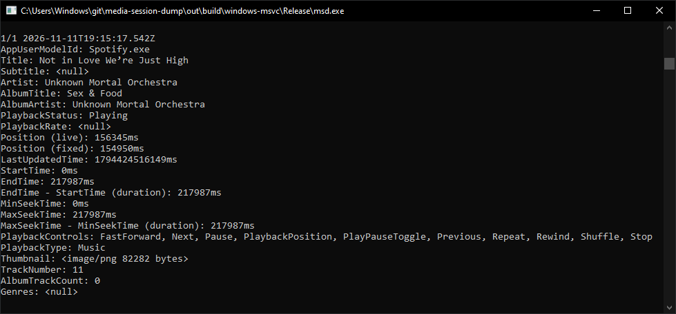

# msd.exe - Media session dump for Windows

Logs all metadata that applications report to your system via System Media Transport Controls (SMTC).

For downloads visit the Releases page: https://github.com/ungive/media-session-dump/releases and download `msd.exe`.

## Screenshot



## Development

Open a "Developer Command Prompt for VS 2022":

```
mkdir build
cd build
cmake ..
cmake --build .
.\Debug\msd.exe
```

## License

Copyright (c) 2024-2026 Jonas van den Berg  
See LICENSE.txt for details.
